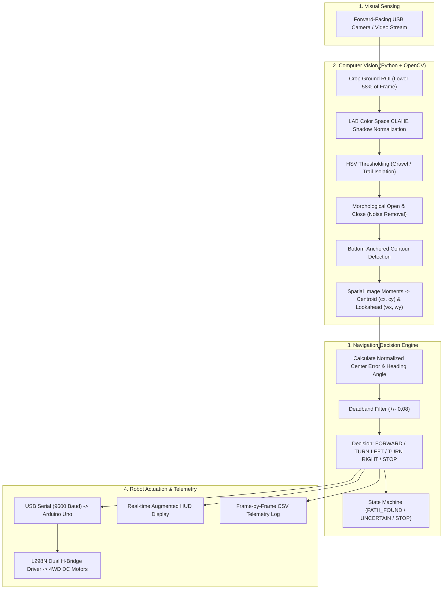

# Academic Project Report & Viva Defense Guide
## Vision-Based Outdoor Navigation for Unmanned Ground Vehicles (UGV)

**Academic Level:** 2nd Year B.Tech / B.E. Engineering Mini-Project  
**Domain:** Robotics, Computer Vision, Embedded Systems  
**Primary Technologies:** Python 3, OpenCV (`cv2`), NumPy, Matplotlib, Arduino Uno, C++  

---

## 1. Project Abstract
Unmanned Ground Vehicles (UGVs) operating in unstructured outdoor environments—such as agricultural fields, hiking trails, and disaster zones—require autonomous navigation without relying exclusively on satellite GPS, which is prone to signal dropouts and multipath interference. 

This project presents a lightweight, vision-based traversable path detection and navigation decision system developed using **Python** and **OpenCV**. Using a single forward-facing monocular camera, the system:
1. Isolates ground-level regions of interest (ROI) to remove sky and horizon noise.
2. Applies illumination and shadow compensation using the `LAB` color space.
3. Segments traversable corridors using `HSV` color masking and morphological filters.
4. Extracts path centroids and lookahead heading waypoints via spatial image moments.
5. Generates real-time steering commands (`FORWARD`, `TURN LEFT`, `TURN RIGHT`, `STOP`) with deadband stability.
6. Logs 10 frame-level telemetry parameters to CSV and provides comprehensive post-run evaluation metrics.

---

## 2. Block Diagram & Architecture



---

## 3. Hardware Specifications & Bill of Materials

| Component | Specification | Purpose in Project |
|---|---|---|
| **Chassis** | 4WD Aluminum/Acrylic Robotic Platform | Houses motors, electronics, and battery |
| **Microcontroller** | Arduino Uno R3 (ATmega328P) | Converts high-level serial commands to motor PWM |
| **Motor Driver** | L298N Dual H-Bridge Driver | Drives 4 DC motors with bidirectional speed control |
| **Motors** | 4 × 12V 100-300 RPM DC Geared Motors | Skid-steer / differential drive locomotion |
| **Camera** | 720p / 1080p USB Webcam (or RPi Cam) | Captures real-time forward terrain imagery |
| **Host Computer** | Laptop / Raspberry Pi 4 / Jetson Nano | Runs the Python + OpenCV vision algorithms |
| **Power Source** | 11.1V 3S LiPo or 2 × 18650 Li-ion (7.4V) | Powers motors via L298N and Arduino via 5V buck |

---

## 4. Hardware Wiring & Pinout Table

```
   [ Laptop / Host PC ] 
           | (USB Cable)
           v
   [ Arduino Uno R3 ]
     Pin 8  --------> L298N IN1  (Left Motor Forward)
     Pin 9  --------> L298N IN2  (Left Motor Backward)
     Pin 10 --------> L298N IN3  (Right Motor Forward)
     Pin 11 --------> L298N IN4  (Right Motor Backward)
     Pin 5 (PWM) ---> L298N ENA  (Left Motor Speed Enable)
     Pin 6 (PWM) ---> L298N ENB  (Right Motor Speed Enable)
     GND -----------> L298N GND  (Common Ground)

   [ Battery 11.1V / 7.4V ]
     Positive (+V) -> L298N 12V Terminal
     Negative (GND)-> L298N GND Terminal & Arduino GND
```

---

## 5. Software Methodology Explained Simply

### Step 1: Region of Interest (ROI) Selection
- **Why?** The upper 42% of a forward-facing camera image contains sky, trees, distant hills, and clouds.
- **How?** `roi = frame[int(h * 0.42):, :]`. This reduces computational load by ~42% and eliminates false detections from tree canopies.

### Step 2: Shadow Compensation via LAB Color Space
- **Why?** Outdoor environments contain harsh sunlight and dark tree shadows. In standard RGB, shadows change all values drastically.
- **How?** Convert frame to `LAB` color space. The $L$ channel contains luminance (light intensity), while $A$ and $B$ contain color. We apply **CLAHE** (Contrast Limited Adaptive Histogram Equalization) to the $L$ channel to balance lighting before converting back.

### Step 3: Color Segmentation via HSV
- **Why?** `RGB` mixes brightness with color. In `HSV` (Hue, Saturation, Value), Hue represents the pure color wavelength, making it resilient to outdoor brightness changes.
- **How?** `cv2.inRange(hsv, lower_bound, upper_bound)` creates a binary mask where path pixels are white (255) and non-path pixels are black (0).

### Step 4: Morphological Filtering (Noise Cleaning)
- **`cv2.morphologyEx(mask, cv2.MORPH_OPEN, kernel)`**: Removes small white specks (grass weeds, pebbles).
- **`cv2.morphologyEx(mask, cv2.MORPH_CLOSE, kernel)`**: Closes black gaps (cracks and small shadows) inside the path.

### Step 5: Bottom-Anchored Contour Detection
- Rather than selecting the largest white blob anywhere in the frame (which could be a clearing far away), the algorithm scores contours based on how close their bottom edge is to the vehicle's bumper. This ensures the rover follows the path connected directly to its wheels.

### Step 6: Path Center & Lookahead Calculation
- Using spatial image moments:
  $$c_x = \frac{M_{10}}{M_{00}}, \quad c_y = \frac{M_{01}}{M_{00}}$$
- The normalized error $e$ is calculated relative to the image center:
  $$e = \frac{c_x - (W / 2)}{W / 2} \quad \in [-1.0, 1.0]$$
- Negative $e$ indicates the path curves left; positive $e$ indicates right.

### Step 7: Deadband Control
- If the error is small ($|e| \le 0.08$, within 8% of the center), the command is **`FORWARD`**.
- This prevents the motors from vibrating/oscillating constantly when the robot is already well-centered.

---

## 6. Top 10 Viva Voce Questions & Model Answers

Here are the questions engineering professors and external examiners typically ask during project evaluation, along with clear, technical answers:

#### Q1. Why did you choose HSV color space instead of standard RGB/BGR?
> **Answer:** In RGB, color and brightness are coupled across all three channels. If a cloud passes over the sun or a tree casts a shadow, R, G, and B values all drop significantly, causing color thresholding to fail. In HSV, Hue ($H$) represents pure color pigment, Saturation ($S$) represents color purity, and Value ($V$) isolates brightness. This allows us to threshold based on terrain color regardless of ambient lighting changes.

#### Q2. What is the purpose of Region of Interest (ROI) cropping?
> **Answer:** The upper half of the frame contains elements irrelevant to ground navigation (sky, clouds, horizon, tree leaves). Cropping to the lower 58% saves roughly 40% of processing time per frame and prevents distant objects with similar color profiles from corrupting path detection.

#### Q3. What is CLAHE and why did you use it?
> **Answer:** CLAHE stands for *Contrast Limited Adaptive Histogram Equalization*. Standard histogram equalization operates globally and washes out outdoor images. CLAHE operates on localized tiles of the image and caps contrast enhancement to prevent noise amplification, making trail boundaries visible even when half the trail is in direct sunlight and half is under dark tree shade.

#### Q4. What is "Deadband" and why is it important in robotics?
> **Answer:** A deadband is a small zone around the target setpoint (in our project, $\pm 0.08$ normalized error) where no corrective steering action is taken. Without a deadband, even a 1-pixel deviation would cause the vehicle to rapidly switch between `TURN LEFT` and `TURN RIGHT`, leading to motor chattering, high mechanical wear, and wasted battery power.

#### Q5. How do you find the center of the path from a binary mask?
> **Answer:** We compute spatial image moments using `cv2.moments()`. The zeroth moment $M_{00}$ gives the total area of the contour, while $M_{10}$ and $M_{01}$ represent the sum of pixel coordinates along the X and Y axes. The centroid is given by $c_x = M_{10}/M_{00}$ and $c_y = M_{01}/M_{00}$.

#### Q6. What happens if the path is temporarily obscured or lost?
> **Answer:** We implemented a Finite State Machine with a 5-frame directional memory (grace period). If the path disappears for a few frames due to dust or glare, the system transitions to `PATH_UNCERTAIN` and safely maintains its last known steering trajectory. If the path is not re-acquired after 5 consecutive frames, it triggers a safety stop (`STOP_NO_PATH`).

#### Q7. How does the Python script communicate with the physical robot?
> **Answer:** The Python system sends single-character ASCII instructions (`'F'`, `'L'`, `'R'`, `'S'`) over a standard USB Serial connection (at 9600 baud) to an onboard Arduino Uno. The Arduino reads the character and triggers the corresponding H-Bridge logic pins on the L298N motor driver to power the 4 DC motors.

#### Q8. What is skid-steering (differential drive)?
> **Answer:** Skid-steering turns the vehicle without mechanical steering racks. To turn left, the left-side wheels rotate backward (or stay still) while the right-side wheels rotate forward. To turn right, the right-side wheels rotate backward while the left-side wheels rotate forward.

#### Q9. How do you evaluate whether the navigation was successful?
> **Answer:** We log every frame's decision, normalized error, and confidence to a CSV file. Using `evaluate_runs.py`, we calculate:
> 1. **Path Detection Consistency %**: Percentage of total frames where the path was tracked.
> 2. **Cross-Track RMSE**: Root-Mean-Square Error of the distance between vehicle center and path center.
> 3. **Steering Jitter Index**: Frequency of decision flips to measure steering smoothness.

#### Q10. What are the future enhancements for this project?
> **Answer:** 
> 1. Replacing color thresholding with lightweight deep learning semantic segmentation (e.g., MobileNetV3-UNet or Fast-SCNN) for diverse terrains (snow, grass, sand).
> 2. Fusing camera vision with an ultrasonic sensor or LiDAR for dynamic obstacle avoidance.
> 3. Adding GPS waypoint following for global route planning while using vision for local corridor centering.

---

## 7. How to Demonstrate During Viva

Run the interactive launcher:
```powershell
python run_project.py
```
From the interactive menu:
1. Select **`[1]`** to show the live video tracking with the augmented HUD overlay.
2. Select **`[2]`** to demonstrate the closed-loop autonomous rover physics simulation.
3. Select **`[6]`** to generate and display the quantitative benchmark graphs and RMSE report.
4. Select **`[7]`** to open the interactive 3D CAD rover model in the web browser.
